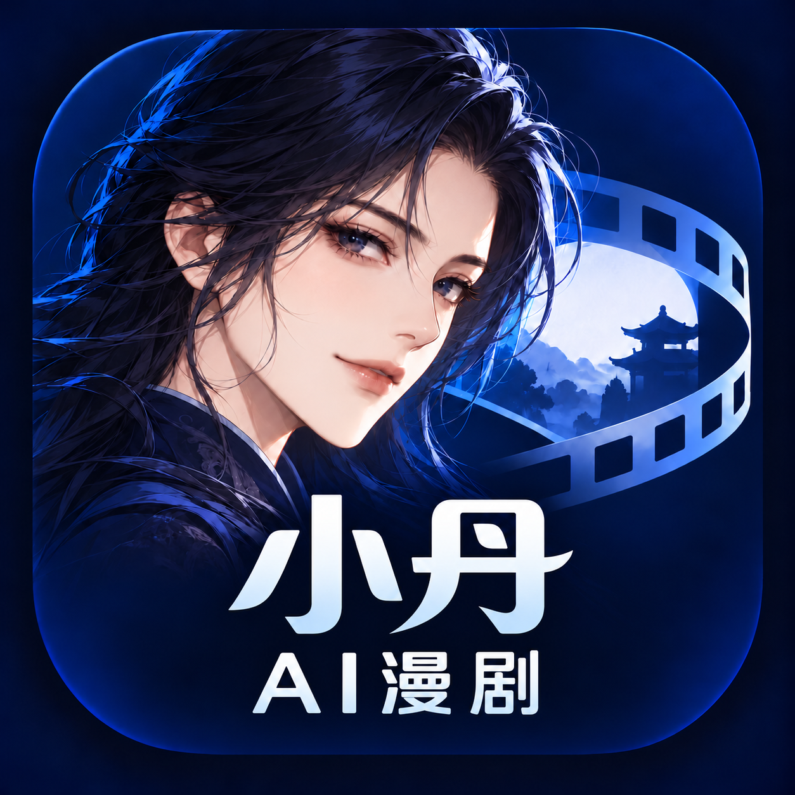

# 小丹AI漫剧



小丹博士的 AI 漫剧创作工具。将故事、剧本、分镜、角色和图片、视频、音频素材放在同一个工作区中创作。

## 下载与反馈

- [安装包构建](https://github.com/ZSCDumin/xiaodan-ai-drama/actions)
- [版本发布](https://github.com/ZSCDumin/xiaodan-ai-drama/releases)
- [问题反馈](https://github.com/ZSCDumin/xiaodan-ai-drama/issues)

目前提供 Windows x64、Mac Apple Silicon、Mac Intel 和 Android ARM64 构建。当前安装包签名状态以对应构建说明为准。
首次使用可配置自己的模型服务，也可以稍后配置。模型费用由用户自己的服务账号承担。

## 本地开发

需要 Bun 1.3.14，依赖版本由 bun.lock 固定。

```sh
bun install --frozen-lockfile
bun run dev
```

常用命令：

```sh
bun run dev:desktop
bun run build:server
bun run package:desktop
```

桌面打包需要对应系统的工具链。Mac Intel 使用 compat/macIntel 兼容构建；Windows 需要 NSIS；Android 的现有构建脚本运行在 Windows，环境准备与打包命令如下：

```sh
bun run --cwd apps/mobile setup
bun run --cwd apps/mobile build
```

GitHub Actions 中的“小丹AI漫剧 Mac 安装包”和“小丹AI漫剧 Windows 与 Android 安装包”会生成安装包。

## 本地授权服务

已提供独立的激活码签发、设备管理、签名租约、续期和撤销服务。启动与接口说明见 [授权服务文档](apps/licenseServer/readme.md)。当前尚未接入 APP 激活界面和支付系统，商用待办见 [商用检查报告](docs/commercialAudit.md)。

## 品牌与版权

Copyright © 2026 ZSCDumin，适用于“小丹AI漫剧”的品牌设计和定制修改。
本项目基于 [Toonflow](https://github.com/HBAI-Ltd/Toonflow-app)，原项目 Copyright © 2026 HBAI-Ltd。原项目及本仓库代码依照 [MIT 许可](LICENSE) 分发；第三方依赖遵守各自许可。

详细说明见 [品牌与开源声明](docs/brandNotice.md)。
